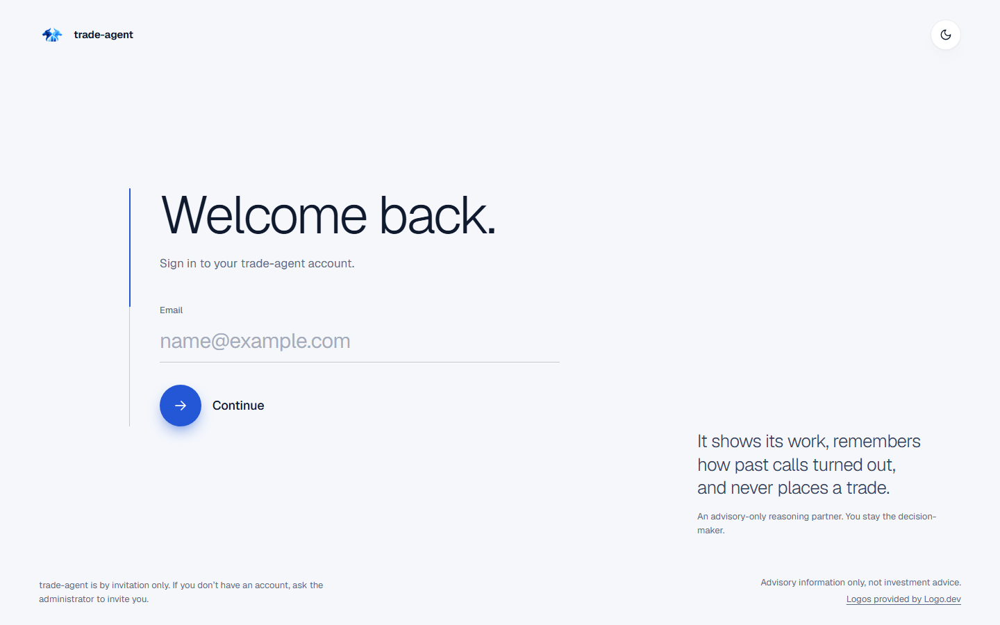
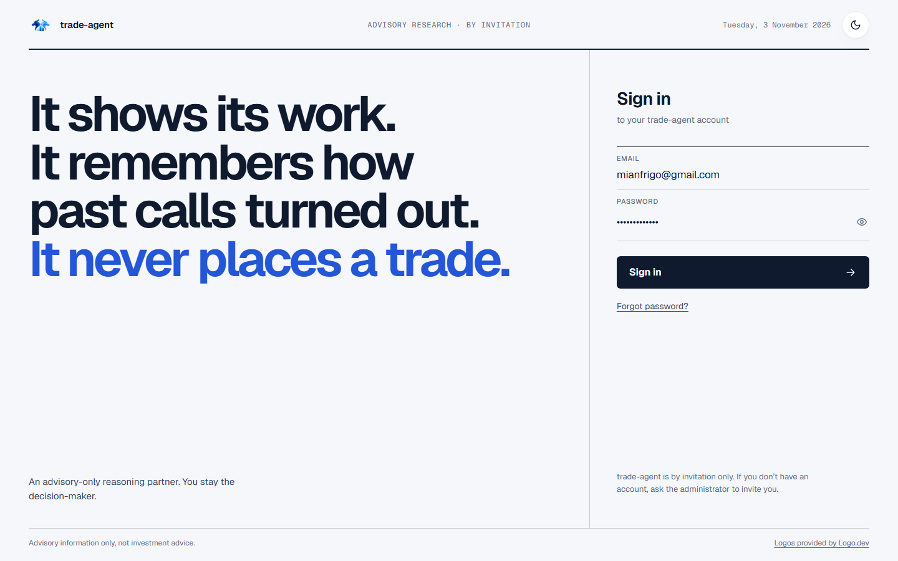
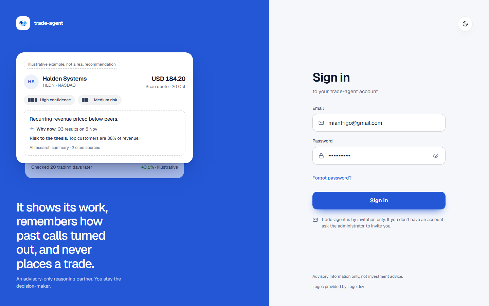
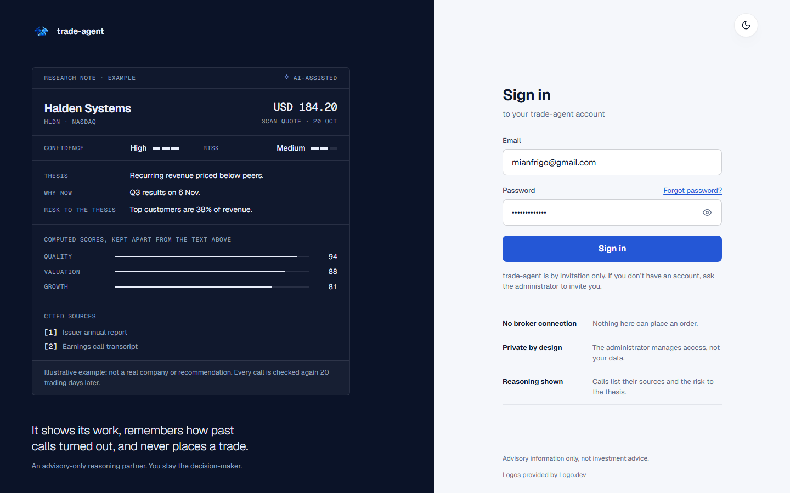
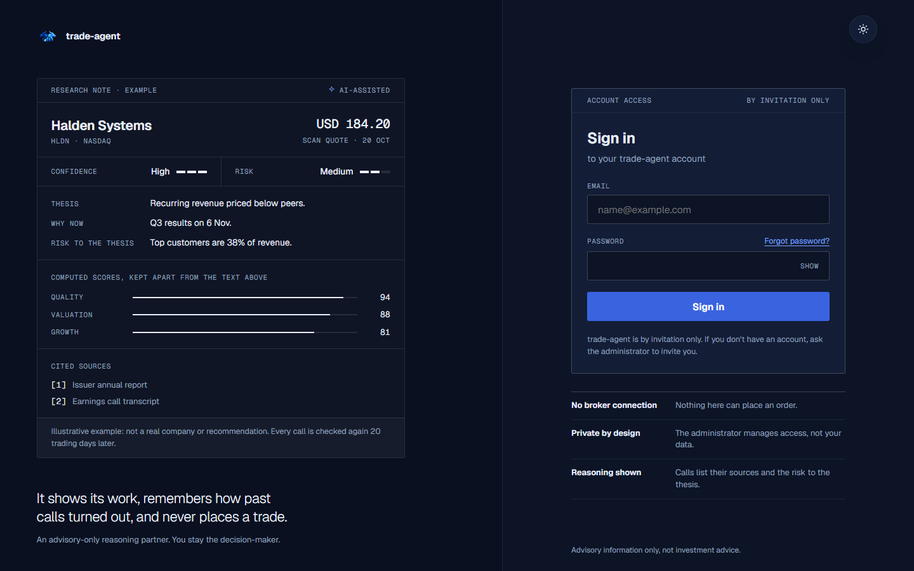
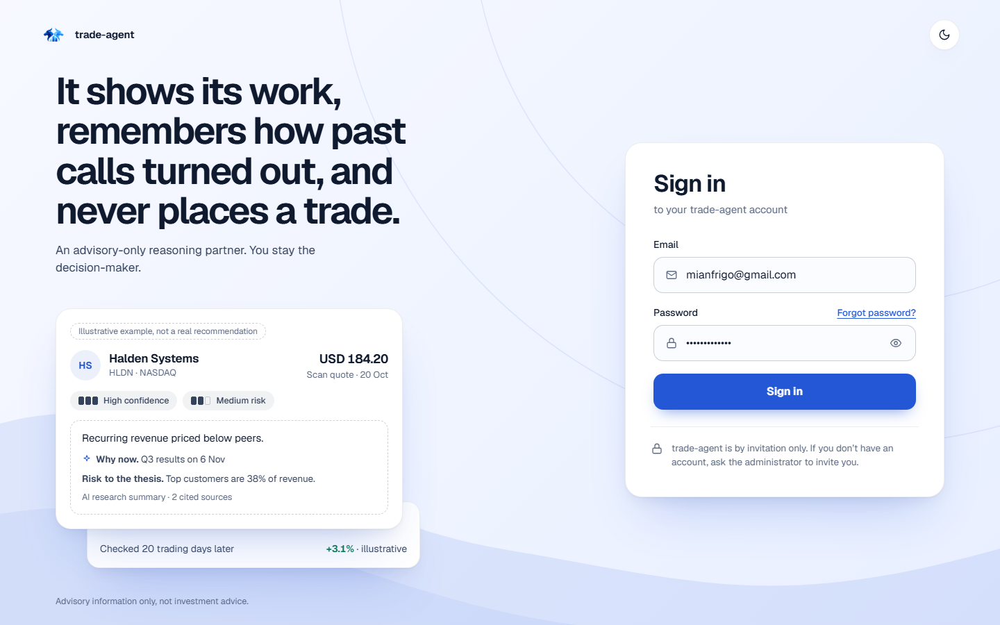
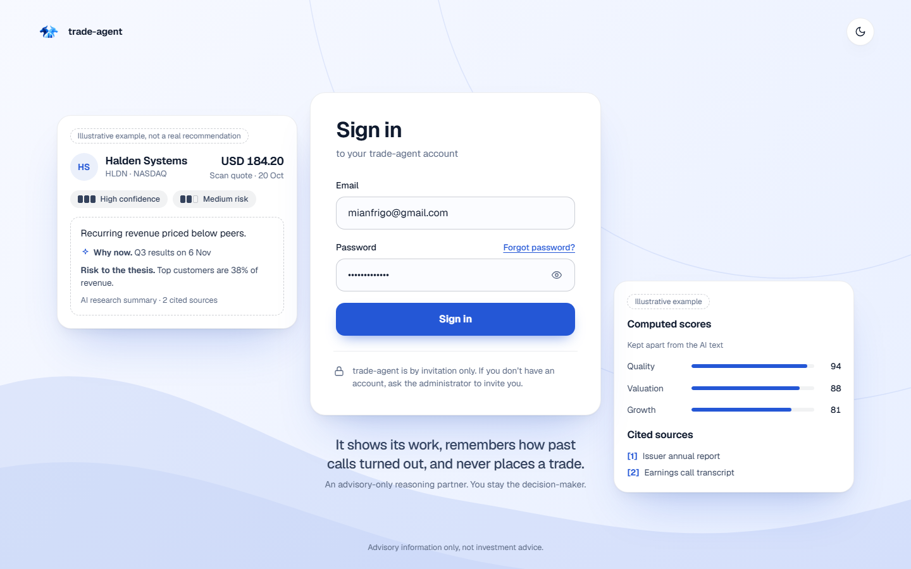
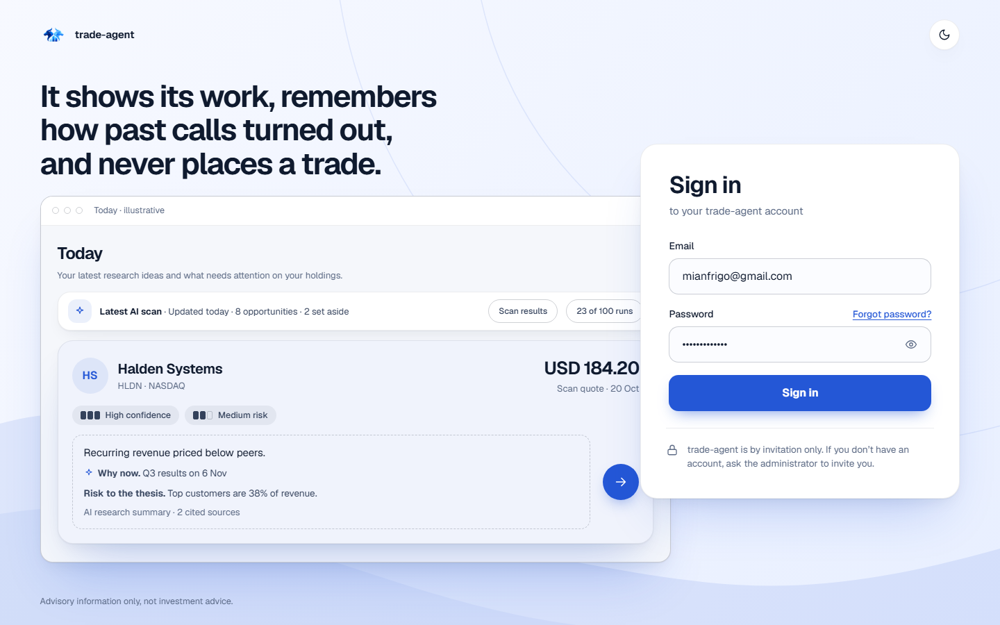

# The signed-out screens, three directions

Proposed 2026-11-03. The owner asked for a redesign of Sign in, Set your password (the invitation), Reset your password and their states that does not look vibecoded and reads as premium, professional and worth a customer's attention, in three options. This is a set of mocks and a plan, not a change to the app. Nothing is approved until the owner picks one; then this folder gets a `direction-approved.md`.

The current screens are the [Soft sign-in restyle](../signin/SPEC.md): a brand half on the left and a flat form on the right. They are correct and consistent, and they look like the default: a split screen, a panel, a button. These three options change the composition, not just the polish.

## What stays fixed in all three

- **The words.** Every string is the app's own: the promise ("It shows its work, remembers how past calls turned out, and never places a trade."), "An advisory-only reasoning partner. You stay the decision-maker.", the invitation-only note, the 24-hour note, the advisory line, the Logo.dev credit, the error and link texts. No new claims.
- **The product truth.** Invitation only, advisory only, never places a trade. The acknowledgement checkbox on the invitation stays.
- **The brand anchors.** Geist (and Geist Mono for datelines), the cobalt accent from `globals.css` (`#2457d6` light, `#7ea3ff` dark), the bull mark, the theme toggle top right, 44px targets, light and dark.
- **The states.** Sign in (also wrong password), Set your password, link not valid, Reset your password (also "Check your email"), Choose a new password.

## The three options

Mocks: [a-door.html](a-door.html), [b-note.html](b-note.html), [c-proof.html](c-proof.html). Each takes `?screen=login|login2|login2err|loginerr|invite|invalid|forgot|sent|reset` and `?theme=dark`. Shots in `shots/`: the sign-in screenshots of every round are kept; the full set (wrong password, invitation, "Check your email", phone) is kept only for the chosen D1, and the other mocks reproduce theirs with `?screen=` and `?theme=`.

### A · The Door (quiet, one question at a time)

Structure: no panel and no brand half. A single column with light-weight display type ("Welcome back."), underline fields at 30px, and one question per step: the email first, then the password. A plumb line on the left fills as you go through. The round cobalt arrow is the Soft system's own Go button, reused as the one action. The promise sits quietly bottom right.

Why it might be the one: it looks the most expensive and the least like a SaaS login. It is also the calmest, which suits an advisory product that never places a trade. Cost: two steps to sign in instead of one screen (a password manager still fills both), and it has the least brand message on screen.

Designer logic: a private-bank or atelier restraint. Dark: [a-login-desk-dark.png](shots/a-login-desk-dark.png). Phone: [a-login-phone-light.png](shots/a-login-phone-light.png).

### B · The Note (editorial, the promise as the headline)

Structure: the first page of a research note. A masthead between two rules (name, "Advisory research · By invitation", today's date), the three clauses of the promise set as the headline in heavy display type with the last clause, "It never places a trade.", in cobalt, and the form as a ruled column on the right, labels as small caps, an ink button. No cards, no rounded panels.

Why it might be the one: it is the boldest and the most memorable, and the headline does the persuading in one glance. It says "serious research" before anyone reads a word. Cost: it is loud next to the calm app behind it, and the ink button breaks the cobalt-for-action rule on these screens only.

Reference logic: the editorial grid of a financial publication, with a Businessweek-style display headline pressed over small running text. Dark: [b-login-desk-dark.png](shots/b-login-desk-dark.png). Phone: [b-login-phone-light.png](shots/b-login-phone-light.png).

### C · The Proof (show the product before the password)

Structure: a drenched cobalt field on the left holding one research card in the app's own anatomy (the two meters, the dashed AI box, "Risk to the thesis", the cited sources) with the track-record strip under it ("Checked 20 trading days later"). The card is an illustration and says so on the card: "Illustrative example, not a real recommendation". The form on the right is plain and fast. On a phone the card goes and a short cobalt band with the promise stays.

Why it might be the one: it proves the claim instead of stating it, and it is the least risky of the three: familiar, fast, one screen. Cost: the split screen is what the current screens already are, so it is the smallest visual step, and the example card must be kept clearly fictional (the company and the +3.1% are made up).

Roulette logic: the dealt composition with the product's own mechanism as the hero. Dark: [c-login-desk-dark.png](shots/c-login-desk-dark.png). Phone: [c-login-phone-light.png](shots/c-login-phone-light.png).

## Comparison

| | A · The Door | B · The Note | C · The Proof |
|---|---|---|---|
| First impression | Calm, expensive | Confident, editorial | Clear, product-led |
| Sign-in steps | 2 (email, then password) | 1 | 1 |
| Brand message on screen | Small, bottom right | The whole left side | A card and a line |
| Distance from today | Large | Large | Small |
| Risk | Fewer people see the promise | Loud next to the app | Looks like other SaaS logins |
| Cobalt used for | The one action and the line | The last clause of the headline | The whole left field and the action |

## Decisions for you

1. **Pick one**, or mix ("A's calm with B's headline", "C but with A's fields"). Say what to change.
2. **The logo.** `los_trading_hermanos_logo.svg` is a 1536×1024 raster in an SVG wrapper. It reads fine at 38px but would blur large, and on a coloured field (C) it needs a white tile. A clean vector mark would let any option use it bigger. Say if you want one made or supplied.
3. **A's two-step sign-in** (only if you pick A): it fills the email first and asks for the password on the next screen. Say if you would rather keep both fields on one screen.
4. **A "Back to sign in" link** on "link not valid" and "Check your email". Today those are dead ends; it is one line of new copy, so the mocks leave it out.

## Not shown, and kept as it is

The checks that stop an invitation or reset link from changing the wrong person's password, redirects and session behaviour: none of that is touched. The off-ramp sizes (px in the mocks) move onto the rem ramp in the build. A 320px and a Logo.dev-credit pass happen in the build's browser round, as for the last restyle.

## Build notes (after a pick)

- Components: `components/auth/AuthShell.tsx` (the frame, brand, heading), `app/login/page.tsx`, `app/accept-invitation/page.tsx`, `app/reset-password/page.tsx`; the fields, buttons and alerts come from the Soft theme in `lib/theme/buildMuiTheme.ts`. The change is mostly the shell and per-screen layout; the flows and tests that assert text, roles and labels stay.
- One PR for all the signed-out screens (they share the frame). A also needs a two-step sign-in state in `login/page.tsx`; B needs the date line (client-side `Intl`, no new data); C needs the illustrative card as a static component with its label.
- DESIGN.md gets the new rules for the signed-out screens once built.

## Second pass on C (2026-11-03): from a template to a document

The owner chose C and said it still reads as a template an LLM made from a stock kit, not something an institutional investor or an enterprise buyer would trust with sensitive data. That is a fair read of C v1, and these were the causes:

- **A flat saturated blue block beside a white form.** The default split screen, with nothing specific to this product.
- **A UI-kit card.** Rounded pills, a tinted dashed box, a glowing round-corner button, an icon inside every field: the shadcn look.
- **An invented performance number.** "+3.1% illustrative" is the thing a careful buyer distrusts most, in the one place that is meant to earn trust.
- **No evidence about the data.** The page asked for a password and said nothing about what the product can and cannot do.

Mock: [c2-proof.html](c2-proof.html) (same `?screen=` and `?theme=` switches). Shots: `shots/c2-*.png`.

What changed:

| C v1 | C2 |
|---|---|
| A rounded card with pills | A research **document**: hairline sections, a labelled header (`Research note · Example`, `AI-assisted`), the quote, confidence and risk as words with a three-tick scale, "Thesis / Why now / Risk to the thesis" as a ruled definition list |
| Text and numbers mixed | The product's own rule made visible: "Computed scores, kept apart from the text above" (a thin-rule score table in mono), and the AI text marked with the spark |
| Invented +3.1% | Gone. The footnote says what is true: "Illustrative example: not a real company or recommendation. Every call is checked again 20 trading days later." |
| A flat cobalt field | The ink of the product's own dark theme in both themes (`#0b1328`), cobalt only on the live elements; hairlines at 11% |
| Icons in fields, 14px corners, a glowing button | Plain fields with the label above, 8px corners, 48px, a flat button; "Forgot password?" on the password label row |
| No assurances | Three facts under the form, in a ruled list: **No broker connection** (nothing here can place an order), **Private by design** (the administrator manages access, not your data), **Reasoning shown** (calls list their sources and the risk to the thesis) |
| One typeface in two weights | Geist for reading, Geist Mono for labels, figures and the quote, tabular numerals |

The three assurance lines come from what the product already does (`AGENTS.md`: no broker API is ever called; `PRODUCT.md`: the admin sees access data, never holdings, recommendations or chats; the app shows sources and the risk to the thesis). They are **new copy**, so they need your approval, and none of them claims a certification or a security standard the product does not have.

### Decisions for you on C2

1. **Approve C2**, or say what still reads as a template.
2. **The three assurance lines** (new copy). Keep, reword or drop.
3. **8px corners and the dark left panel in both themes.** Both leave the Soft system's 14px radius and light left side for these screens only. Say if the signed-out screens should match the app instead.
4. **The logo.** Still the raster bull; at 34px on the ink it holds, larger it would blur. A vector mark would lift the whole page.
5. The earlier open points still apply: a "Back to sign in" link on the dead-end screens.

## Third pass on C (2026-11-03): the form as an instrument

The owner's notes after C2: no icons in the inputs, no Logo.dev text and no default badges, sharper geometry and no soft pills or blue gradients, and a page that looks authoritative, dark and precise. Mock: [c3-proof.html](c3-proof.html) (dark by default; add `?theme=light` for light). Shots: `shots/c3-*.png`.

| Note | In C3 |
|---|---|
| Kill the input icons | None in any field. Labels sit above the field in small mono capitals. The show-password control is the word "Show", not an eye |
| Strip the Logo.dev text | Removed from every signed-out screen (see the credit below) |
| Default error badges | None on the page. The wrong-password message is one plain bordered line of text, no icon. The red icons in the first screenshot were drawn by a password-manager extension in the browser, not by the page, and the page does not try to hide them: suppressing a password manager's autofill makes an institutional login less safe |
| Sharper geometry, no pills or gradients | 3px corners on the panel, fields, button and the document; no pills, no shadows, no gradient anywhere; hairline rules |
| Tighten the form container | The form is a ruled instrument panel: a header strip (`Account access`, `By invitation only`), the fields, and the invitation note inside it, mirroring the research document on the left |
| Precision typography | Geist for reading, Geist Mono for labels, figures and the quote; tabular numerals; heading 24px |
| Gravity: dark, authoritative | Dark is the default on these screens (light stays one tap away on the toggle); the button is a deeper cobalt (`#3a63e0`) on dark, because the pale periwinkle read as friendly |

### The Logo.dev credit

Logo.dev's [attribution rules](https://docs.logo.dev/platform/attribution) ask for a visible "Logos provided by Logo.dev" link next to where logos are shown, for commercial projects on the free plan; personal projects and paid plans do not need it. The sign-in screens show no logo, so the credit does not belong there. But today they are the only place that carries it, so **removing it from sign-in means moving it into the signed-in app** (a quiet line in the footer of More, or under the logo lists on Today, Discover and Portfolio) in the same build, if you are on the free plan and the use counts as commercial. If you are unsure, Logo.dev says to ask them.

### Decisions for you on C3

1. **Approve C3**, or say what still looks generic.
2. **Dark by default** on the signed-out screens (a stored light choice would still win). It means a first-time visitor sees dark.
3. **The three assurance lines** under the form (new copy; each is something the product already does).
4. **The Logo.dev credit:** move it into the signed-in app (my suggestion, in the same PR), or tell me you are exempt and it can go.
5. **The logo mark** is still a raster; a vector version would sharpen it at the top left.
6. Still open from before: a "Back to sign in" link on the dead-end screens.

## Round 4 (2026-11-03): the modern soft look from the owner's reference image

The owner went back to C v1 and brought a reference image: a pale blue field with soft curves and a faint ring, a big tight headline, a research card stacked over a track-record strip, and a white rounded form card with deep soft shadows. They asked for something modern like it, in three options. C2 and C3 (the document and instrument versions) stay in this folder as the record of the other direction.

All three share one build (`d.css`, `d.js`) so they are comparable: the same background, the same form card, the same research card in the app's own anatomy; each one changes the composition. Light and dark, 1440px, 390px and the other screens (`?screen=invite|loginerr|sent|...`, `?theme=dark`) in `shots/d1-*`, `d2-*`, `d3-*`. No horizontal overflow at 390px.

### D1 · The Reference ([d1-reference.html](d1-reference.html))

The image as drawn: headline top left, the research card over the track-record strip bottom left, the form card on the right, icons in the fields as in the reference. Two columns. The closest to the image and the least risky. It keeps the reference's "+3.1%", labelled illustrative (see the decisions).

### D2 · The Stage ([d2-stage.html](d2-stage.html))

The form is the centre of the page; the product sits on both sides of it (a research card on the left, computed scores and cited sources on the right) and the promise is one line below. Calmer than D1, with the focus on signing in; the product is supporting evidence. No icons in the fields, no made-up performance.

### D3 · The Window ([d3-window.html](d3-window.html))

The real product: the Today screen (the scan bar and the top opportunity, in the app's own components) in a window on the left, the form card overlapping its edge, the headline above. The strongest "this is a working product" signal, and the one that shows the most of what the app does. No icons in the fields. On a phone the window goes and the headline and form stay.

### What these keep and what they leave out

- **Kept:** the app's words, invitation only, the advisory line, the cobalt accent and Geist, light and dark, 44px targets.
- **Left out on purpose:** the reference's **Continue with Google** button. The product has no Google sign-in (access is by invitation and email and password), so it would be a promise the app cannot keep; adding it is an auth change, not a visual one. Also left out: the Logo.dev credit (these screens show no logo; see the Logo.dev note above for where it goes in the app).

### Decisions for you

1. **Pick one**, or mix ("D2's stage with D3's window on one side").
2. **The "+3.1%"** in D1 is the reference's number. It is labelled illustrative, but it is still a performance figure made up for a page that asks for trust. D2 and D3 have none. Keep it, or drop it from D1.
3. **Icons in the fields.** The reference has them and D1 follows it; D2 and D3 leave them out, as you asked in the previous round. Say which you want.
4. **Soft or serious.** D1-D3 are the soft, light-first look of the reference. C3 is the dark, ruled, institutional one. They are two different answers to the same brief; this round answers the reference.
5. **Light by default** here (the reference is light), against C3's dark default.
6. The earlier open points still apply: the logo is a raster; a "Back to sign in" link on the dead-end screens; the three assurance lines from C2/C3 are not used in D1-D3 (say if you want them under the form).
